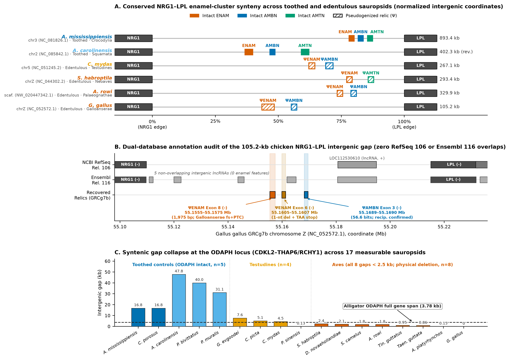
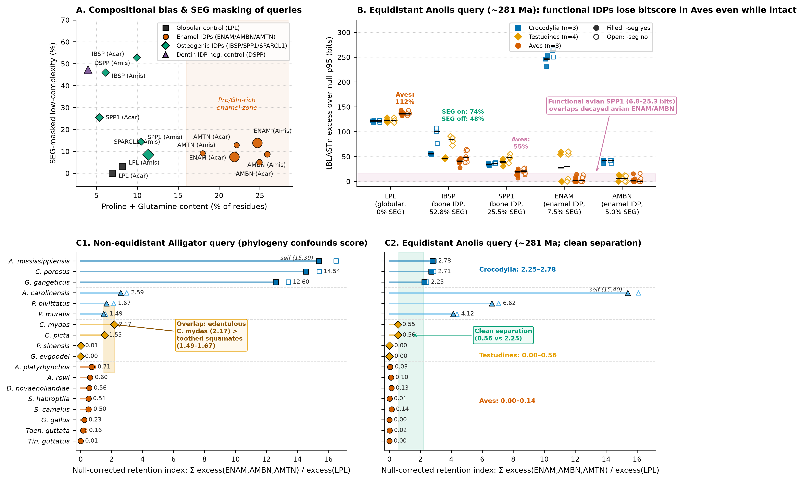
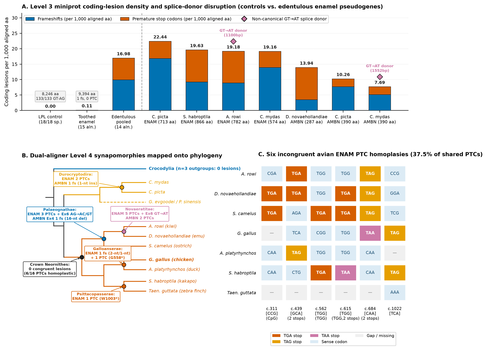

# Unannotated Enamel-Gene Relics on the Avian Z Chromosome, Disordered-Protein Homology Bias, and Phylogenetic Limits of Inactivating-Mutation Dating in Birds and Turtles

**Matheus Lima**¹\*

¹ Independent Researcher, Brazil  
\* Correspondence: `limatheus458@gmail.com` · ORCID: [0009-0000-3557-8337](https://orcid.org/0009-0000-3557-8337)  
Target bioRxiv Subject Area: **Evolutionary Biology** (secondary: **Genomics**)

---
## Abstract

Convergent tooth loss in birds and turtles inactivated enamel matrix protein genes (*ENAM*, *AMBN*, *AMTN*), leaving sequence relics whose detection and dating are confounded by annotation blind spots and structural disorder. We audited 18 sauropsid RefSeq reference assemblies alongside *Gallus gallus* `GRCg7b` Ensembl Release 116 across the conserved *NRG1–LPL* enamel cluster. Both NCBI RefSeq Release 106 and Ensembl Release 116 omit all enamel genes in `GRCg7b`, yet synteny-anchored searches recover single-copy, whole-proteome reciprocal-confirmed relics of *ΨENAM* Exon 8 (`NC_052572.1:55,155,480–55,157,464`, `−`), *ΨENAM* Exon 6 (`55,160,529–55,160,677`, `−`, bearing a 1-nt deletion and in-frame `TAA` stop), and *ΨAMBN* Exon 3 (`55,168,855–55,168,992`, `−`) with zero annotation overlap, plus a reciprocal-confirmed *ΨAMTN* relic in kakapo (`NC_044302.2:51,216,319–51,216,444`, `−`). Conversely, automated RefSeq pipelines misannotate pseudogenized enamel loci as `PROTEIN_CODING` in four edentulous genomes. Equidistant *Anolis* queries (~281 Ma) with 20 composition-matched permutations reveal that intact osteogenic intrinsically disordered proteins (*IBSP*, *SPP1*) lose 26–52% of excess `tBLASTn` bitscore in birds—overlapping decayed avian *ENAM*/*AMBN*—whereas globular *LPL* scores 112% of crocodylian levels, demonstrating that bitscore attenuation alone cannot diagnose pseudogenization. Splice-aware `miniprot` alignment detects >150-fold coding-lesion enrichment in edentulous enamel loci (16.98 vs. 0.11 lesions/1,000 aa in toothed controls; 0.00 across 18/18 *LPL* controls, 133/133 canonical `GT-AG` introns) and disrupted `GT→AT` splice donors. Dual-aligner (`MAFFT L-INS-i` + `MUSCLE 5`) consensus recovers 23 shared lesions dating Palaeognathae, Novaeratitae, Galloanserae, Psittacopasserae, and Durocryptodira, but 0 crown Neornithes synapomorphies, with 6/16 (37.5%) shared avian *ENAM* premature stops representing homoplasies.

#[
  #set par.line(numbering: none)
  #v(0.2em)
  #text(font: "Lato", size: 8.6pt, fill: luma(50))[
    **Keywords:** comparative genomics; paleogenomics; edentulism; enamel matrix proteins; intrinsically disordered proteins; pseudogene dating
  ]
]

// =============================================================================
// 1. INTRODUCTION
// =============================================================================
## 1. Introduction

Mineralized teeth have been lost independently across multiple vertebrate lineages, including the stem lineages of crown birds (Aves, ~116 Ma) and crown turtles (Testudines, ~157–210 Ma) as well as several placental mammal clades (Davit-Béal et al., 2009; Meredith et al., 2013; Meredith et al., 2014) @brocklehurst2021. Because tooth enamel mineralization requires a specialized subset of secretory calcium-binding phosphoprotein (*SCPP*) genes—chiefly enamelin (*ENAM*), ameloblastin (*AMBN*), amelotin (*AMTN*), and amelogenin (*AMELX*)—together with maturation factors such as odontogenesis-associated phosphoprotein (*ODAPH*, formerly *C4orf26*) and matrix metalloproteinase 20 (*MMP20*), relaxed purifying selection following edentulism leaves decaying molecular fossils (pseudogenes) embedded in conserved genomic neighborhoods (Kawasaki & Weiss, 2003; Kawasaki, 2009; Meredith et al., 2009; Springer et al., 2016; Liang et al., 2021; Kawasaki et al., 2023) @chun2025.

Foundational paleogenomic studies established the core architecture of sauropsid enamel-gene decay. Sire et al. (2008) identified a degraded amelogenin pseudogene (*ΨAMEL*, `EU340348`) on chicken chromosome 1 while inferring complete deletion of other enamel loci in early chicken assemblies. Shortly thereafter, Al-Hashimi et al. (2010) demonstrated that in sauropsids the *ENAM–AMBN–AMTN* enamel subcluster resides in a translocated syntenic neighborhood flanked by *NRG1* and *LPL*—distinct from the ancestral *SPARCL1–SIBLING* cluster retained on mammalian chromosome 4—and reported the first chicken *ENAM* pseudogene fragment in that region. Subsequent comparative analyses documented widespread inactivating mutations in *ENAM*, *AMBN*, *AMTN*, *AMELX*, *MMP20*, and *DSPP* across turtles (Meredith et al., 2013) and 48 avian genomes @meredith2014, inferring a single loss of mineralized teeth in the common ancestor of crown birds and documenting parallel regression across toothless mammals (Springer et al., 2019; Mu et al., 2021; Randall et al., 2022; Emerling et al., 2023; Randall et al., 2024) @emerling2026. Recent developmental work has also linked ciliary and signaling regulators such as *C2CD3* to avian tooth suppression alongside structural enamel-gene decay @kantaputra2026.

Despite this empirical foundation, three pervasive methodological vulnerabilities affect modern paleogenomic surveys of tooth-gene loss—and comparative analyses of trait loss more broadly. First, automated gene-annotation pipelines (NCBI RefSeq and Ensembl) exhibit bidirectional errors on degenerating loci: they routinely omit genuine pseudogene fragments even in modern chromosome-level reference genomes while occasionally projecting erroneous `PROTEIN_CODING` models onto frame-disrupted pseudogenes (Weisman et al., 2022) @kirilenko2023. Second, enamel matrix proteins are proline- and glutamine-rich intrinsically disordered proteins (IDPs) lacking globular catalytic domains (Kawasaki & Weiss, 2006; Kawasaki et al., 2021) @chun2025. In translated sequence searches (`tBLASTn`), compositional bias, low-complexity filtering (`SEG`), and phylogenetic asymmetry systematically depress alignment bitscores even for intact, fast-evolving IDPs (Wootton & Federhen, 1993; Wootton & Federhen, 1996; Schäffer et al., 2001; Yu et al., 2003; Yu & Altschul, 2005; Altschul et al., 2005; Gertz et al., 2006; Weisman et al., 2020) @chow2024. Treating depressed translated-alignment bitscores as proxies for pseudogenization risks conflating evolutionary disorder with gene inactivation. Third, dating ancient trait losses via shared premature termination codons (PTCs) is vulnerable to mutational convergence (homoplasy) at hypermutable triplets (e.g., `CpG` dinucleotides and `TGG` tryptophan codons) and alignment-dependent gap placement (Meredith et al., 2014) @emerling2026.

To separate empirical replication from original methodological and genomic findings, we designed a deterministic, four-level audit ("Evidence Ladder") across 18 high-contiguity sauropsid RefSeq reference genomes (6 toothed controls and 12 edentulous birds and turtles, anchored against human `GRCh38.p14`). While replicating and extending prior paleogenomic discoveries of avian and testudine enamel pseudogenes (Al-Hashimi et al., 2010; Meredith et al., 2013) @meredith2014, this study makes four original contributions:
1. A dual-database annotation audit (NCBI RefSeq Release 106 and Ensembl Release 116) proving that *all* enamel loci remain completely unannotated in the modern chromosome-level reference *Gallus gallus* `GRCg7b` while establishing exact, single-copy, whole-proteome reciprocal-confirmed `GRCg7b` coordinates of *ΨENAM* Exon 8, *ΨENAM* Exon 6 (bearing a direct frameshift and premature stop), and *ΨAMBN* Exon 3 on chromosome Z, alongside a reciprocal-confirmed *ΨAMTN* relic on kakapo (*Strigops habroptila*) chromosome Z.
2. A quantitative 18-species benchmark of compositional and `SEG`-masking bias in translated homology searches, contrasting functional osteogenic IDPs (*IBSP*, *SPP1*, *SPARCL1*) against a globular flanking control (*LPL*) using equidistant *Anolis* queries (~281 Ma) and 20 composition-preserving permutations.
3. A splice-aware `miniprot` coding-lesion and `GT-AG` splice-site audit across all 18 *NRG1–LPL* intervals showing that replacing a truncated legacy GenBank enamelin sequence (`QOX06214.1`, 849 aa) with full-length RefSeq *ENAM* (`XP_019346377.1`, 1,078 aa) unlocks previously invisible pseudogene exons and canonical `GT→AT` splice-donor disruptions while exposing a 58.4-kb distal low-complexity chaining artifact in *Chrysemys picta*.
4. A dual-aligner (`MAFFT L-INS-i` + `MUSCLE 5`) consensus analysis of shared inactivating mutations and exon splice borders across avian and testudine *ENAM* and *AMBN*, quantifying a 37.5% (6/16) homoplasy rate among shared avian *ENAM* PTCs and demonstrating why multi-nucleotide frameshift indels and canonical splice-site disruptions outperform isolated PTCs for deep-time pseudogene dating.

// =============================================================================
// 2. RESULTS
// =============================================================================
## 2. Results

### 2.1. Level 1 Annotation Audit Reveals Both Unannotated Relics and Automated Coding False Positives

Across the 18 sauropsid RefSeq reference assemblies audited via NCBI Datasets v2 (all current chromosome-, contig-, or scaffold-level reference genomes; Table S1), the nine-gene canonical odontogenic panel (*ENAM*, *AMBN*, *AMTN*, *AMELX*, *MMP20*, *DSPP*, *ODAM*, *ODAPH*, *ACP4*) is completely represented in the mammalian outgroup *Homo sapiens* `GRCh38.p14` (9/9 genes annotated as `PROTEIN_CODING`), whereas toothed sauropsids carry 4–7 officially annotated tooth genes per genome (7 in *Alligator mississippiensis*, 6 in *Crocodylus porosus* and *Anolis carolinensis*, 5 in *Python bivittatus*, and 4 in *Gavialis gangeticus* and *Podarcis muralis*). Missing official symbols in toothed species reflect nomenclature and pipeline gaps rather than biological absence: *Alligator* *ODAPH* is annotated as an uncharacterized locus (`LOC106740521`, `XP_019349100.2`, `NC_081825.1:164,672,404–164,676,187`), and functional *Anolis* and *Podarcis* *ODAPH* orthologs are misannotated as non-coding RNAs (Table S1, Table S6).

Conversely, automated RefSeq annotation generated false-positive `PROTEIN_CODING` gene models on demonstrably pseudogenized loci in 4 of the 12 edentulous genomes (Table S1): *Chrysemys picta* (*ENAM*, chr6), *Chelonia mydas* (*AMBN*, chr5), *Struthio camelus* (*AMELX*, chr1), and *Apteryx rowi* (*AMELX*, unplaced scaffold). Level 3 alignment below confirms multiple frameshifts, premature stops, and a `GT→AT` splice-donor disruption directly inside the RefSeq-annotated *C. picta* *ENAM* and *C. mydas* *AMBN* coding models.

In *Gallus gallus* `GRCg7b` (`GCF_016699485.2`), zero of the nine odontogenic genes are annotated genome-wide in either NCBI RefSeq Annotation Release 106 (released 2021-12-23) or Ensembl Release 116 (`Gallus_gallus.bGalGal1.mat.broiler.GRCg7b.116.gtf.gz`, SHA-256 `407e3e27...`). Within the conserved 105,218-bp intergenic interval between *NRG1* (`NC_052572.1:54,642,186–55,109,784`, `−`) and *LPL* (`55,215,002–55,232,438`, `−`), RefSeq Release 106 annotates a single uncharacterized lncRNA (`LOC112530610`, `55,180,611–55,194,886`, `+`) and Ensembl Release 116 annotates five intergenic lncRNAs (`ENSGALG00010014552` through `ENSGALG00010014761`), none of which overlap the enamel-gene relics recovered below (Figure 1B; Table 1).

### 2.2. Level 2 Syntenic Recovery and Whole-Proteome Reciprocal Validation Across 18 Sauropsids

As first noted for chicken *ENAM* @alhashimi2010, the sauropsid *ENAM–AMBN–AMTN* enamel cluster is conserved in strict synteny between *NRG1* and *LPL* (adjacent to *PSD3*) across all four extant reptile and bird clades (Figure 1A; Table S2a). Flanking *NRG1* and *LPL* anchors were recovered on the same chromosome or scaffold in 16 of 18 species (with single-anchor ±800-kb windows used for *Dromaius novaehollandiae* and *Tinamus guttatus* where one flanking symbol is unannotated in RefSeq), spanning 402–1,097 kb in toothed Crocodylia and Squamata, 160–337 kb in Testudines, and 105–330 kb on chromosome Z (or homologous scaffolds) in Aves.

**Figure 1.** Conserved *NRG1–LPL* enamel-cluster synteny, dual-database annotation audit of *Gallus gallus* `GRCg7b` chromosome Z, and *ODAPH* syntenic gap collapse. (**A**) Normalized intergenic positions (0% = *NRG1* boundary, 100% = *LPL* boundary; inverted scaffolds oriented *NRG1* → *LPL*) of intact enamel genes (solid boxes) and whole-proteome reciprocal-confirmed pseudogene relics (*Ψ*, hatched boxes) across six representative sauropsids. (**B**) High-resolution map of the 105.2-kb *NRG1–LPL* intergenic interval on `GRCg7b` chrZ (`NC_052572.1:55.098–55.236 Mb`), contrasting NCBI RefSeq Release 106 and Ensembl Release 116 features against three completely unannotated relics recovered in this study (*ΨENAM* Exon 8, *ΨENAM* Exon 6, and *ΨAMBN* Exon 3; vertical shading confirms zero overlap). (**C**) Intergenic gap length between flanking anchors (*CDKL2* and *THAP6*/*RCHY1*/*PARM1*/*SCLT1*) at the *ODAPH* locus across 17 measurable sauropsids; all eight birds and *Pelodiscus sinensis* exhibit gaps shorter than the 3.78-kb *Alligator* *ODAPH* gene span (dashed line), demonstrating physical deletion.

To establish orthology rigorously without small-database ascertainment bias, every candidate `tBLASTn` hit (bitscore ≥ 28 or *E* ≤ 0.01) in all 18 *NRG1–LPL* intervals was tested by reciprocal `BLASTx` against the entire *Alligator mississippiensis* RefSeq proteome (48,040 proteins, `GCF_030867095.1`) both at the clustered locus-span level and at the individual top-HSP exon level (±30 bp; Table S2b). Evaluating both windows exposed a subtle analytical pitfall: when multi-exon pseudogene spans encompass >5 kb of degraded intronic sequence (*Struthio* and *Apteryx* *AMBN*, span 5.3 kb), intronic transposable or uncharacterized hits outscore the short ~150-bp coding exon in full-span `BLASTx`, whereas top-HSP exon reciprocal `BLASTx` unequivocally confirms *Alligator* ameloblastin as the proteome-wide best hit (*Struthio*: `XP_019346384.1`, 51.2 bits, *E* = 9.5×10−9 vs. runner-up 28.9 bits; *Apteryx*: `XP_019346385.1`, 50.8 bits, *E* = 8.9×10−9 vs. runner-up 32.7 bits).

In *Gallus gallus* `GRCg7b` chromosome Z (`NC_052572.1`), three distinct unannotated relics preserve the exact ancestral transcriptional orientation (`−` strand) and physical order (`ENAM` Exon 8 → `ENAM` Exon 6 → `AMBN` Exon 3; Table 1, Figure 1B):
- ***ΨENAM* Exon 8** (`NC_052572.1:55,155,480–55,157,464`, `−`, 1,975 bp aligned to kakapo Exon 8 at *E* = 7.3×10−87, 317 bits; core `tBLASTn` vs. full RefSeq *Alligator* `ENAM` `55,155,480–55,157,125`, 40.8 bits, *E* = 1.2×10−4): single-copy in the *NRG1–LPL* interval (1 hit in `dc-megablast`), with whole-proteome reciprocal `BLASTx` returning *Alligator* enamelin (`XP_019346375.1`, 41.6 bits, *E* = 0.004 full span; `XP_019346377.1`, 41.6 bits, *E* = 2.7×10−5 top HSP) and zero non-enamelin hits at *E* ≤ 10 across 48,040 proteins in the full span.
- ***ΨENAM* Exon 6** (`NC_052572.1:55,160,529–55,160,677`, `−`, 149 bp, situated 3.06 kb upstream of Exon 8 and 1.11 kb downstream of the non-overlapping Ensembl lncRNA `ENSGALG00010014557`): recovered at 78.0% nucleotide identity (*E* = 2.7×10−27, 115 bits) against kiwi *ENAM* Exon 6 and carrying a direct 1-nt frameshift deletion plus an in-frame `TAA` premature stop codon (`cag|atttacaac-TAA-gaggcttct...`) while retaining canonical `AG...GT` splice borders (Table S5b).
- ***ΨAMBN* Exon 3** (`NC_052572.1:55,168,855–55,168,992`, `−`, 138 bp): single-copy (1 `dc-megablast` hit), forward `tBLASTn` 56.6 bits (*E* = 4.0×10−10, 50.0% identity over 46 aa), whole-proteome reciprocal `BLASTx` confirmed to *Alligator* ameloblastin (`XP_019346384.1`, 45.8 bits, *E* = 5.1×10−7 top HSP vs. non-ortholog runner-up 26.6 bits).

Beyond chicken, whole-proteome reciprocal validation confirmed *ΨENAM* in 7 of 8 birds (all except *Tinamus guttatus*, whose weak 29.6-bit hit reciprocally matched kinase `DCLK3`) and in *Chrysemys picta* and *Chelonia mydas* (plus a marginal 30.0-bit, *E* = 0.25 fragment in *Pelodiscus sinensis*, whereas *Gopherus evgoodei*'s 29.3-bit hit failed reciprocity). Crucially, we confirmed an unannotated ***ΨAMTN* relic on kakapo chromosome Z** (*Strigops habroptila* `bStrHab1.2.pri`, `NC_044302.2:51,216,319–51,216,444`, `−`, 126 bp, `tBLASTn` 37.4 bits, *E* = 2.8×10−4; reciprocal best hit across 48,040 proteins = *Alligator* amelotin `XP_014451634.1`, 38.1 bits, *E* = 1.9×10−4 vs. runner-up 26.9 bits) positioned in exact ancestral syntenic order downstream of *ΨENAM* (Table 1; Figure 1A). A lower-confidence *ΨAMTN* top-HSP candidate also occurs in exact syntenic order in mallard duck (*Anas platyrhynchos*, `NC_092621.1:53,220,153–53,220,311`, `+`, `tBLASTn` 34.3 bits, *E* = 3.0×10−3; top-HSP reciprocal `XP_014451634.1`, 35.0 bits, *E* = 5.0×10−3, though its 7.6-kb multi-HSP span is masked by an intronic hit to `LOC132245913`, 134 bits; Table S2b).

**Table 1.** Summary of key unannotated avian enamel-gene relics audited in *Gallus gallus* `GRCg7b` (`GCF_016699485.2`, RefSeq Release 106 & Ensembl Release 116) and *Strigops habroptila* (`GCF_004027225.2`), alongside empirical blind-spot calibration on chicken *ΨAMEL* (`EU340348`). *Forward `tBLASTn` core spans `55,155,480–55,157,125` (40.8 bits); full Exon 8 alignment to *S. habroptila* spans `55,155,480–55,157,464` (1,975 bp, 317 bits, *E* = 7.3×10−87). †`BLASTn` against *A. rowi* *ENAM* Exon 6. Full 18-species reciprocal results in Table S2b.

**(See compiled PDF `manuscript_biorxiv.pdf` or `manuscript.typ` for formatted table layout; full underlying data in `supplementary/`.)**

Four auxiliary controls reinforce and delimit these Level 2 findings (Table S6):
1. ***ODAPH* physical deletion vs. *ODAM* uninformative negative:** Across 17 measurable sauropsids, toothed controls retain 16.8–47.8 kb between *CDKL2* and the adjacent downstream anchor (*THAP6*/*PARM1*), housing an intact 3,784-bp *ODAPH* gene in *Alligator* (Figure 1C). All eight birds exhibit drastic syntenic gap collapse to 0–2,447 bp (`0 bp` in *G. gallus*, `146 bp` in *A. platyrhynchos*, `859–2,447 bp` in the remaining six birds), and *Pelodiscus sinensis* collapses to `132 bp`—physically shorter than the *Alligator* *ODAPH* locus and providing Level 2 evidence of deletion rather than sequence divergence. By contrast, *ODAM* yielded no significant hit even in toothed *Alligator*, *Anolis*, or *Python* (best `tBLASTn` *E* ≥ 0.21; mammalian/amphibian sensitivity test on *Xenopus* yielded *E* = 0.042–1.6), classifying *ODAM* absence as an uninformative Level 1 negative.
2. **Empirical `tBLASTn` blind-spot calibration (*ΨAMEL*):** The chicken *ΨAMEL* pseudogene sequenced by Sire et al. (2008) (`EU340348`) maps at 100.0% nucleotide identity across four exon blocks (513 bp) to `GRCg7b` chr1 (`NC_052532.1:124,410,142–124,413,840`, `−`) between intact flanking anchors *MSL3* (121 bits) and *MID1* (455 bits). Yet querying this exact interval with *Alligator* `AMELX` yields 0 HSPs under `-seg yes` and a noise-floor 25.8 bits under `-seg no`, proving that absence of `tBLASTn` signal cannot rule out a retained pseudogene relic.
3. **Independent whole-genome alignment coverage (`multiz100way`):** Across 29 human `hg38` coding exons of *ENAM*, *AMBN*, and *AMTN*, UCSC `multiz100way` independently aligns 56.4–63.0% of *ENAM* CDS in *C. mydas* and *C. picta*, 41.0% in *Amazona vittata*, and 64.4% of *AMBN* CDS in two falcons (*Falco cherrug*, *F. peregrinus*); however, functional *Alligator* (`allMis1`) yields 54 raw frameshifts against `hg38`, restricting `multiz100way` strictly to coverage-only support (Table S6).
4. **Chromosome Z recombination context:** Anchoring `GRCg7b` chicken *ΨENAM* and *ΨAMBN* to `galGal3` via exact 32-mer matching (4,380/4,380 and 1,893/2,650 concordant 32-mers) places both relics inside recombination bin 1784 of the Elferink et al. (2010) linkage map (male recombination rate 3.94 cM/Mb; *NRG1–LPL* window weighted average 2.27 cM/Mb, 54th percentile of 122 chrZ bins vs. chrZ mean 3.00 and autosomal mean 2.97 cM/Mb; genome-wide baseline from Groenen et al. (2009)), rejecting a recombination cold-spot explanation for relic persistence.

### 2.3. Compositional, SEG-Masking, and Phylogenetic Bias in Translated Searches of Enamel IDPs

Sequence profiling with `segmasker` (`-window 12 -locut 2.2 -hicut 2.5`) confirms stark compositional divergence between globular flanking controls and mineralized-tissue IDPs (Figure 2A; Table S3a). Globular *LPL* exhibits low Pro+Gln content (6.9–8.2%), high Shannon entropy (4.19–4.22 bits/aa), and 0.0% (*Anolis*) to 3.1% (*Alligator*) `SEG`-masked residues. By contrast, sauropsid enamel proteins (*ENAM*, *AMBN*, *AMTN*) contain 18.0–25.9% Pro+Gln and 46.6–57.3% disorder-promoting SCPP residues (P, Q, S, D, E, G, N), with 5.0–13.9% `SEG`-masked sequence. Functional osteogenic SCPP/SIBLING IDPs (*IBSP*, *SPP1*, *SPARCL1*)—intact across all 18 amniotes—exhibit even stronger low-complexity enrichment, reaching 25.5% (*SPP1*) and 52.8% (*IBSP*) `SEG`-masked residues in *Anolis* (14.4% and 46.0% in *Alligator*), while the cross-chromosome negative control *DSPP* is 47.4% `SEG`-masked.

Evaluating null-corrected retention indices (`sum excess(ENAM, AMBN, AMTN) / excess(LPL)`, using 20 composition-matched random permutations per query, seed `20261017`) across all 18 species reveals two compounding artifacts in translated bitscore metrics (Figure 2B–C; Table 2, Table S3b–c):

First, **phylogenetic query asymmetry confounds non-equidistant scores.** When queried with full-length *Alligator* proteins (`-seg yes`), crocodylians score 12.60–15.39, toothed squamates (diverged ~281 Ma per TimeTree 5, Kumar et al. (2022)) drop to 1.49–2.59, and edentulous *Chelonia mydas* (2.17) and *Chrysemys picta* (1.55) directly overlap or exceed toothed *Python bivittatus* (1.67) and *Podarcis muralis* (1.49; Figure 2C1). Switching to an equidistant *Anolis carolinensis* query—diverged ~281 Ma identically from Crocodylia, Testudines, and Aves—eliminates this phylogenetic overlap cleanly: toothed Crocodylia score 2.25–2.78, edentulous Testudines drop to 0.00–0.56, and Aves drop to 0.00–0.14 (Figure 2C2).

Second, and more fundamentally, **functional intrinsically disordered proteins suffer steep bitscore attenuation in Aves even under purifying selection.** Under the equidistant *Anolis* query (Table 2; Figure 2B):
- Globular ***LPL*** (`0.0%` SEG) is completely invariant to `-seg yes` vs. `-seg no` and scores *higher* in Aves (median 136.1 bits, range 132.3–143.4, **111.7%** of Crocodylia 121.8 bits), ruling out generalized avian substitution-rate acceleration or locus-wide alignment breakdown across the *NRG1–LPL* interval.
- Functional bone ***IBSP*** (`52.8%` SEG) drops in Aves to median 40.9 bits (**73.8%** of Crocodylia 55.4) under `-seg yes`, and when low-complexity masking is disabled (`-seg no`), Crocodylia jumps to 100.3 bits while Aves rises only to 48.0 bits (**47.9%** of Crocodylia). Using closer archosaurian *Alligator* queries (~240 Ma), functional avian *IBSP* drops to just 8.1–27.7 bits excess (median 17.1, **15.0%** of Crocodylia 114.1 bits; Table S3c).
- Functional bone ***SPP1*** (`25.5%` SEG) drops in Aves to median 19.0 bits (**54.9%** of Crocodylia 34.6 bits; range **6.8–25.3 bits** under `-seg yes`), directly overlapping the excess bitscore range of decayed avian *ENAM* (0.0–14.4 bits) and *AMBN* (0.0–15.3 bits; Figure 2B).

The cross-chromosome negative control *DSPP* (located outside *NRG1–LPL*) confirmed near-zero median excess (0.0 bits across all four clades under both `-seg yes` and `-seg no`, max observed 29.6 bits), while exposing an edge-case `SEG` artifact where heavy masking collapsed *DSPP* shuffle baselines to 0.0 in one turtle (Table S3c). Together, these controls prove quantitatively that depressed `tBLASTn` bitscores in Pro/Gln- or Asp/Glu-rich IDPs cannot serve as standalone evidence of pseudogenization.

**Figure 2.** Quantitative dissection of compositional, `SEG`-masking, and phylogenetic bias in translated homology searches across 18 sauropsids. (**A**) Pro+Gln fraction versus `SEG`-masked low-complexity fraction (`segmasker`) across 14 representative queries (marker area proportional to protein length). (**B**) Equidistant *Anolis carolinensis* (~281 Ma) `tBLASTn` excess bitscores above the 20-shuffle 95th-percentile null (`-seg yes`, filled symbols; `-seg no`, open symbols; horizontal black bars = clade medians) across Crocodylia (*n* = 3), Testudines (*n* = 4), and Aves (*n* = 8). Globular *LPL* scores 111.7% of crocodylian levels in birds with zero `SEG` effect, whereas functional osteogenic IDPs (*IBSP*, *SPP1*) lose 26–52% of excess bitscore in birds—with intact avian *SPP1* (6.8–25.3 bits) directly overlapping decayed avian *ENAM*/*AMBN* (shaded pink band). (**C1–C2**) Null-corrected retention indices across all 18 species under (**C1**) non-equidistant *Alligator* full RefSeq queries (where edentulous *C. mydas* 2.17 overlaps toothed squamates 1.49–1.67) versus (**C2**) equidistant *Anolis* queries (clean separation: Crocodylia 2.25–2.78 vs. Testudines 0.00–0.56 and Aves 0.00–0.14).

**Table 2.** Clade medians (and min–max ranges) of `tBLASTn` excess bitscores above the 20-shuffle 95th-percentile null under equidistant *Anolis carolinensis* queries (`-seg yes` vs. `-seg no`). Values are read directly from Table S3c. Functional avian *SPP1* (6.8–25.3 bits) overlaps decayed avian *ENAM* (0.0–14.4 bits) and *AMBN* (0.0–15.3 bits).

**(See compiled PDF `manuscript_biorxiv.pdf` or `manuscript.typ` for formatted table layout; full underlying data in `supplementary/`.)**

### 2.4. Level 3 Splice-Aware Coding Lesions and Splice-Site Disruptions

To separate structural pseudogenization from fast-evolving functional disorder, we aligned full-length *Alligator* RefSeq proteins (`ENAM` `XP_019346377.1`, 1,078 aa; `AMBN` `XP_019346386.1`, 390 aa; `AMTN` `XP_014451634.1`, 328 aa; flanking positive control `LPL` `XP_019346320.1`, 477 aa) across all 18 *NRG1–LPL* intervals with `miniprot` (v0.18-r281; Figure 3A, Table S4).

The flanking positive control ***LPL*** aligned cleanly across **18/18 species** (8,246 aligned aa total: 2,695 toothed + 5,551 edentulous) with **0 frameshifts, 0 premature stop codons (0.00 lesions/1,000 aa), and 133/133 canonical `GT-AG` introns** (0 non-canonical splice junctions), ruling out systematic `miniprot` alignment artifacts or assembly-quality confounding across the exact same genomic intervals. Similarly, toothed enamel controls (*n* = 15 alignments spanning 9,394 aligned aa across Crocodylia and Squamata, with *Gavialis* *AMTN* partially truncated by its 14.8-kb scaffold contig N50) exhibited only 1 isolated `miniprot` frameshift call in *Anolis* *AMBN* (`fs@171` at 45.6% aa identity across ~281 Ma divergence, despite an intact native RefSeq ORF `NP_001315156.1` of 377 aa), establishing an empirical cross-clade alignment false-positive floor of **0.11 lesions/1,000 aa** (0 premature stop codons; 92/93 canonical `GT-AG` introns).

In stark contrast, edentulous enamel pseudogenes exhibited **41 frameshifts and 29 premature stop codons** (70 coding lesions across 4,122 pooled aligned aa = **16.98 lesions/1,000 aa**, or **17.49 lesions/1,000 aa** across the 7 substantial lesioned alignments spanning 4,002 aa—a **>150-fold enrichment** above the empirical toothed floor; Figure 3A):
- *Chrysemys picta* *ENAM*: 12 frameshifts + 4 PTCs (22.44/1,000 aa across 713 aa, 66.1% cov) — directly invalidating its RefSeq `PROTEIN_CODING` annotation.
- *Strigops habroptila* *ENAM*: 8 frameshifts + 9 PTCs (19.63/1,000 aa across 866 aa, 80.3% cov).
- *Apteryx rowi* *ENAM*: **7 frameshifts + 8 PTCs (19.18/1,000 aa across 782 aa, 72.5% cov) plus a disrupted `GT→AT` splice donor** spanning a 1,100-bp intron (Intron 6). Notably, using the legacy partial GenBank entry `QOX06214.1` (849 aa, missing 212 N-terminal residues) completely failed to align *A. rowi* *ENAM* (0% coverage; Table S4), demonstrating how query completeness governs pseudogene recovery.
- *Chelonia mydas* *ENAM*: 8 frameshifts + 3 PTCs (19.16/1,000 aa across 574 aa, 53.2% cov).
- *Dromaius novaehollandiae* *AMBN*: 1 frameshift + 3 PTCs (13.94/1,000 aa across 287 aa, 73.6% cov).
- *Chrysemys picta* *AMBN*: 3 frameshifts + 1 PTC (10.26/1,000 aa across 390 aa, 100% cov).
- *Chelonia mydas* *AMBN*: **2 frameshifts + 1 PTC (7.69/1,000 aa across 390 aa, 100% cov) plus a disrupted `GT→AT` splice donor** spanning a 1,552-bp intron (Intron 8) — directly invalidating its RefSeq `PROTEIN_CODING` annotation.

Because `miniprot` depends on seeded 4-mer amino-acid chains against a crocodylian query, highly degraded avian *ENAM* loci falling below ~35% protein identity with dense frameshifts (*G. gallus*, *A. platyrhynchos*, *D. novaehollandiae*, *S. camelus*) were not spanned by `miniprot` even though intra-avian nucleotide `BLASTn` (63–89% nt identity) readily recovered 1.7–2.5 kb of orthologous Exon 8 and Exon 6 in all seven birds for Level 4 analysis below. Audit of `miniprot` intron lengths also uncovered an instructive quality-control failure mode: full-length `ENAM` initially chained an implausible 58.4-kb intron in *C. picta* to an upstream 382-bp low-complexity hit (`NC_088796.1:129,180,576–129,180,957`), which whole-proteome reciprocal `BLASTx` proved was **protein SON** (*E* = 0.010), not enamelin. Imposing a biological 25,000-bp maximum-intron filter segmented this distal chaining artifact cleanly without altering any genuine enamelin exon (Table S4).

### 2.5. Level 4 Dual-Aligner Shared Inactivating Mutations, Splice Disruptions, and Pervasive PTC Homoplasy

To test which inactivating lesions reflect shared ancestry versus convergent decay, we extracted verified coding exons of *Alligator* *ENAM* (Exons 6 and 8; complete 8-exon CDS = 3,237 bp, 100% exact translation to `XP_019346377.1`) and *AMBN* (Exons 3, 4, and 9; complete 9-exon CDS = 1,173 bp, 100% exact translation to `XP_019346386.1`), recruited homologous avian and testudine fragments, and aligned each exon independently with **MAFFT `L-INS-i`** (v7.525) and **MUSCLE 5** (v5.3) alongside all three toothed crocodylians (*Alligator*, *Crocodylus*, *Gavialis*). All three crocodylian controls yielded **0 coding lesions in both aligners across every dataset** (Table S5a).

Requiring exact reference coordinate, mutation-class, and carrier-set agreement across both aligners is intentionally conservative—filtering out alignment-sensitive indels whose gap boundaries shift by 1–2 nt between MAFFT and MUSCLE (e.g., yielding 17 dual-aligner consensus sites from 31 MAFFT and 33 MUSCLE candidates in avian *ENAM* Exon 8). Across all datasets, this strict consensus yielded **23 robust shared coding mutations** (17 phylogenetically congruent synapomorphies and 6 incongruent homoplasies) plus **2 shared Exon 6 splice-border disruptions** (Figure 3B–C; Table 3, Table S5a–b):

1. **Palaeognathae (*Apteryx*, *Dromaius*, *Struthio*):** Anchored by a **16-nt frameshift deletion in *AMBN* Exon 4** (codon 109 of `XP_019346386.1`, verified outside homopolymer runs), **3 congruent PTCs in *ENAM* Exon 8** (`Q370**` `CAA→TGA`, `F601**` `TTT→TAA`, `W751**` `TGG→TGA`), and a **shared 3' splice-acceptor disruption at *ENAM* Exon 6* (`AG→AC` in *Struthio* and *Apteryx*, further mutated to `GT` in *Dromaius*, while *Alligator*, *Gallus*, and *Anas* preserve canonical `AG`).
2. **Novaeratitae (*Apteryx* + *Dromaius*):** Anchored by **5 congruent PTCs in *ENAM* Exon 8** (`G270**`, `S401**`, `S559**`, `Q667**`, `H844**`), **2 congruent PTCs in *AMBN* Exon 3** (`S56**` `TCA→TAA`, `Q62**` `CAA→TGA`), and a **shared canonical 5' splice-donor disruption at *ENAM* Exon 6 (`GT→AT`)* confirming the `miniprot` lesion independently across both ratite assemblies.
3. **Galloanserae (*Gallus* + *Anas*):** Adding *Gallus gallus* Exon 8 (1,975 bp) directly into the 7-bird alignment recovered **1 congruent frameshift indel** (2-nt insertion relative to crocodylians at codon 619, equivalent to a 1-nt deletion within an ancestral avian 3-nt insertion) plus **1 congruent PTC** (`G558*` `GGA→TGA`), dating chicken *ENAM* inactivation minimally to crown Galloanserae.
4. **Psittacopasserae (*Strigops* + *Taeniopygia*):** Anchored by **1 congruent PTC** in *ENAM* Exon 8 (`W1003*` `TGG→TGA`).
5. **Crown Durocryptodira (*Chelonia* + *Chrysemys*):** Anchored by **1 congruent 1-nt frameshift insertion in *AMBN* Exon 4** (codon 123) and **2 congruent PTCs in *ENAM* Exon 8** (`Q753**` `CAG→TAG`, `A859**` `GCA→TGA`), dating testudine inactivation minimally to crown Durocryptodira (~105–157 Ma).
6. **Crown Neornithes — Zero Congruent Lesions and 37.5% PTC Homoplasy:** Across all 7 aligned birds, **zero coding lesions or splice disruptions were shared congruently across crown Neornithes** (Figure 3B). Strikingly, **6 of the 16 dual-aligner shared avian *ENAM* PTCs (37.5%)** are phylogenetically incongruent homoplasies spanning disjoint clades (Figure 3C; Table S5a). Their sequence context explains this convergence mechanistically: 1 occurs at a hypermutable `CpG` dinucleotide (codon 311 `CCG→TGA` in *Dromaius* + *Struthio* while *Apteryx* retains `CGA`), 2 occur at single-step `TGG` tryptophan hotspots (codons 562 and 615), and **3 of the 6 homoplastic sites carry distinct stop triplets across lineages**—proving independent mutational origins directly from triplet identity. Most tellingly, at *ENAM* codon 684 (ancestral `CAA`), all three palaeognaths share a `CAA→TAG` transition (a genuine Palaeognathae synapomorphy), whereas *Gallus gallus* independently mutated the exact same codon to `TAA` while *Anas* and *Strigops* retain sense `CAA` (Figure 3C).

**Figure 3.** Level 3 coding-lesion accumulation and Level 4 dual-aligner phylogenetic mapping of shared inactivating mutations and PTC homoplasy. (**A**) Level 3 `miniprot` coding-lesion rates (frameshifts in blue, PTCs in vermilion, per 1,000 aligned aa) contrasting 18/18 flanking *LPL* positive controls (0.00/1,000 aa, 133/133 canonical `GT-AG` introns) and 15 toothed enamel alignments (0.11/1,000 aa empirical cross-clade floor) against pooled and individual edentulous pseudogenes (16.98/1,000 aa pooled); magenta diamonds mark disrupted `GT→AT` splice donors in *A. rowi* *ENAM* and *C. mydas* *AMBN*. (**B**) Cladogram of sampled sauropsids showing all 17 dual-aligner (`MAFFT L-INS-i` + `MUSCLE 5`) phylogenetically congruent coding synapomorphies and 2 *ENAM* Exon 6 splice-border disruptions mapped to crown nodes (0 lesions in all 3 crocodylian outgroups; 0 congruent lesions at crown Neornithes). (**C**) Per-species codon matrix across the six phylogenetically incongruent avian *ENAM* Exon 8 PTCs (37.5% of shared PTCs), displaying exact stop triplets (`TGA`, `TAG`, `TAA`), intact sense codons, and gaps; three sites (`c.439`, `c.615`, `c.684`) carry two distinct stop codons across clades, providing direct triplet-level proof of convergent origin.

**Table 3.** Summary of Level 4 dual-aligner (`MAFFT L-INS-i` + `MUSCLE 5`) consensus shared inactivating mutations and Exon 6 splice-border disruptions across avian and testudine *ENAM* and *AMBN* (0 lesions across all 3 crocodylian outgroups in every dataset; full per-site details in Table S5a–b).

**(See compiled PDF `manuscript_biorxiv.pdf` or `manuscript.typ` for formatted table layout; full underlying data in `supplementary/`.)**

// =============================================================================
// 3. DISCUSSION
// =============================================================================
## 3. Discussion

### 3.1. Calibrating Replication Against Original Contributions

Our findings build directly upon the classic paleogenomic demonstration of independent tooth loss in birds and turtles (Sire et al., 2008; Al-Hashimi et al., 2010; Meredith et al., 2013) @meredith2014. Specifically, prior work first identified the translocated *NRG1–LPL* location of sauropsid *ENAM–AMBN–AMTN*, recovered avian *ENAM*/*AMBN*/*AMTN* fragments in earlier draft assemblies, and documented physical loss of *ODAPH* in edentulous lineages (Al-Hashimi et al., 2010; Meredith et al., 2013; Meredith et al., 2014) @springer2016. Against that established baseline, our systematic 18-genome audit delivers four distinct empirical and methodological advances: (1) dual-database proof (`RefSeq 106` and `Ensembl 116`) that *all* enamel relics remain completely unannotated in the modern chromosome-level chicken reference `GRCg7b`, accompanied by exact single-copy, whole-proteome reciprocal-confirmed coordinates—including the lesion-bearing *ΨENAM* Exon 6 (`NC_052572.1:55,160,529–55,160,677`, `−`) and a reciprocal-confirmed *ΨAMTN* relic on kakapo chromosome Z (`NC_044302.2:51,216,319–51,216,444`, `−`); (2) quantitative 18-species proof that functional osteogenic IDPs (*IBSP*, *SPP1*) undergo severe translated bitscore collapse in birds overlapping decayed enamel pseudogenes; (3) demonstration that replacing truncated GenBank queries with full-length RefSeq orthologs recovers previously invisible pseudogene exons and splice disruptions (e.g., *Apteryx rowi* *ENAM*) while requiring intron-length filters to reject low-complexity chaining artifacts (`protein SON` in *C. picta*); and (4) dual-aligner quantification showing that 37.5% (6/16) of shared avian *ENAM* premature stop codons are homoplastic.

### 3.2. Bidirectional Blind Spots of Automated Genome Annotation

Automated annotation pipelines remain the entry point for most large-scale comparative genomic scans, yet our Level 1 audit illustrates why annotation tables alone are unreliable for inferring gene presence or loss (Weisman et al., 2022) @kirilenko2023. In *Gallus gallus* `GRCg7b`, both NCBI RefSeq Release 106 and Ensembl Release 116 report zero enamel genes despite three single-copy, syntenic, whole-proteome reciprocal-confirmed exon relics residing in a normal-recombination region of chromosome Z (54th percentile of chrZ recombination bins) @elferink2010. Equally concerning is the converse error: four edentulous RefSeq assemblies (*C. picta*, *C. mydas*, *S. camelus*, *A. rowi*) annotate frame-disrupted or splice-mutated enamel loci as `PROTEIN_CODING`, while functional toothed-reptile *ODAPH* loci are labeled uncharacterized (`LOC106740521`) or non-coding RNA. Without synteny-anchored sequence extraction and coding-frame verification, database-level presence/absence matrices systematically inject both false negatives and false positives into genotype–phenotype association frameworks (Prudent et al., 2016; Kowalczyk et al., 2019; Saputra et al., 2021) @redlich2024.

### 3.3. Why Intrinsically Disordered Proteins Break Naive Homology Metrics

Enamel matrix proteins evolved within the SCPP family as flexible calcium- and mineral-binding scaffolds rich in Pro, Gln, Ser, and acidic residues (Kawasaki & Weiss, 2006; Kawasaki et al., 2021; Kawasaki et al., 2023) @chun2025. Standard `tBLASTn` scoring matrices and `SEG` low-complexity masking were engineered primarily for globular domains (Wootton & Federhen, 1993; Schäffer et al., 2001; Yu et al., 2003) @gertz2006. Our equidistant *Anolis* benchmark (~281 Ma to Crocodylia, Testudines, and Aves) isolates the resulting failure mode cleanly: intact globular *LPL* shows zero `SEG` sensitivity and scores 111.7% of crocodylian bitscore in birds, ruling out generalized avian rate acceleration across this locus. Yet intact, functionally indispensable osteogenic IDPs (*IBSP*, *SPP1*) lose 26–52% of their excess bitscore in birds—dropping to 6.8–25.3 bits for avian *SPP1*, completely overlapping decayed avian *ENAM* (0.0–14.4 bits) and *AMBN* (0.0–15.3 bits).

This empirical overlap echoes theoretical predictions of homology detection failure in fast-evolving disordered regions (Weisman et al., 2020; Chow et al., 2024) and yields a concrete methodological prescription for paleogenomics: **bitscore attenuation in IDPs should never be interpreted as pseudogenization without corroborating Level 3 coding lesions or Level 2 physical gap collapse.** Our empirical blind-spot calibration on chicken *ΨAMEL* (`EU340348`) underscores the symmetric caveat: a confirmed 513-bp pseudogene yields zero `tBLASTn` HSPs under default `-seg yes`, confirming that absence of translated sequence similarity does not prove physical deletion. Furthermore, our top-HSP vs. full-span reciprocal `BLASTx` comparison highlights that whole-proteome reciprocity should be evaluated at the exon level whenever multi-kilobase pseudogene introns can harbor transposable-element hits.

### 3.4. Homoplastic Premature Stops Versus Indel and Splice-Site Synapomorphies

Dating ancient phenotypic losses from shared inactivating mutations assumes that identical lesions across descendant clades reflect a single ancestral mutational event rather than convergence (Meredith et al., 2013; Meredith et al., 2014) @emerling2026. Our dual-aligner consensus analysis demonstrates why premature stop codons carry a high homoplasy burden after >100 Myr of neutral evolution: over one-third (6/16 = 37.5%) of dual-aligner shared PTCs in avian *ENAM* Exon 8 are phylogenetically incongruent, driven by `CpG` deamination (`c.311`), single-step `TGG` tryptophan transitions (`c.562`, `c.615`), and multi-stop hits (`c.439`, `c.615`, `c.684`) where distinct stop triplets (`TAG` vs. `TAA` or `TGA`) directly betray independent origins. Notably, Meredith et al. (2014) detected a shared crown-avian frameshift deletion in *ENAM* across a much broader 48-bird sampling and inferred a single avian tooth loss ~116 Ma consistent with Mesozoic fossil transitions @brocklehurst2021; in our 8-bird RefSeq panel, nucleotide divergence and partial exon deletion prevented recovering any single crown-Neornithes synapomorphy, whereas lower-homoplasy multi-nucleotide frameshift indels (Palaeognathae *AMBN* Exon 4 16-nt deletion; Galloanserae *ENAM* Exon 8 codon 619 frameshift) and canonical splice-junction disruptions (Palaeognathae *ENAM* Exon 6 `AG→AC/GT`; Novaeratitae `GT→AT`) provided crisp, aligner-invariant minimum dates for crown subclades and crown Durocryptodira.

### 3.5. Limitations

Five limitations delimit the scope of our conclusions and motivate targeted follow-up work:
1. **Phylogenetic sample size and inferential scope:** Although our panel spans 18 genomes across all four major sauropsid clades, birds and turtles represent only *n* = 2 independent evolutionary origins of edentulism. Because trait-association p-values across *n* = 2 evolutionary replicates are severely underpowered and confounded by shared ancestry @saputra2021, all clade comparisons here are intentionally descriptive and anchored by within-genome controls (*LPL*, *IBSP*, *SPP1*, crocodylian outgroups).
2. **Assembly contiguity heterogeneity:** While 14 of 18 reference genomes are chromosome-level or complete T2T assemblies (including `GRCg7b`, `IASCAAS_PekinDuck_T2T`, and `ASM5242630v1`), four assemblies remain scaffold- or contig-level (*Gavialis* contig N50 14.8 kb; *Crocodylus* 34.1 kb; *Apteryx rowi* `aptRow1` 129.4 kb; *Tinamus* 3.85 Mb; Table S1). Isolated base-call or homopolymer indels cannot be excluded in lower-contiguity assemblies; however, our key Level 4 synapomorphies are independently validated across high-contiguity assemblies (*D. novaehollandiae* N50 24.2 Mb + *S. camelus* 28.8 Mb + *A. rowi*; *G. gallus* 18.8 Mb + T2T *A. platyrhynchos* 80.2 Mb; *C. mydas* 39.4 Mb + *C. picta* 13.4 Mb).
3. **Testudine basal sampling:** All four sampled turtles belong to Cryptodira (three Durocryptodira + one Trionychia, *Pelodiscus sinensis*). Inclusion of chromosome-level Pleurodira assemblies is required to test whether *ENAM*/*AMBN* frameshifts predate crown Testudines around ~157–210 Ma (Shaffer et al., 2013) @meredith2013.
4. **Assembly version alignment in auxiliary *ODAPH* panel:** Primary *NRG1–LPL* and *IBSP–SPP1* analyses for *Pelodiscus sinensis* use its current T2T reference genome (`GCF_052426305.1`, released 2025-09-03, annotated 2026-10-19), whereas auxiliary *ODAPH* gap coordinates for *P. sinensis* (`NC_134715.1`, 132-bp gap) originate from the prior RefSeq representative (`GCF_049634645.1`), explicitly noted in Table S6.
5. **Selection-intensity and transcriptional profiling:** Branch-specific **dN/dS** relaxation modeling (e.g., `HyPhy RELAX`) and embryonic oral RNA-seq verification of residual *ΨENAM*/*ΨAMBN* transcription were outside the scope of this genomic audit and represent logical next steps.

// =============================================================================
// 4. MATERIALS AND METHODS
// =============================================================================
## 4. Materials and Methods

### 4.1. Taxon Sampling and Dual-Database Annotation Audit

Eighteen sauropsid NCBI RefSeq reference genomes (3 Crocodylia, 3 Squamata, 4 Testudines, 8 Aves) plus *Homo sapiens* `GRCh38.p14` (`GCF_000001405.40`) were audited programmatically via the NCBI Datasets v2 REST API and `datasets` CLI (`v18.38.0`, audited `2026-11-19`; complete accessions, assembly N50s, and annotation release dates in Table S1). For *Gallus gallus* `GRCg7b` (`GCF_016699485.2`), we downloaded and locally parsed both NCBI RefSeq Annotation Release 106 (`Ggal_genomic.gff`) and Ensembl Release 116 (`Gallus_gallus.bGalGal1.mat.broiler.GRCg7b.116.gtf.gz`, SHA-256 `407e3e270da9668eecc205b685493d157abbd8fa80bc698a65bfd3ed3a5f8009`) to check genome-wide odontogenic symbols and coordinate overlaps within `NC_052572.1:55,109,000–55,235,000`.

### 4.2. Syntenic Interval Extraction and Query Composition Controls

For each of the 18 sauropsids, two genomic windows were retrieved via NCBI E-utilities (`efetch`): (i) the *NRG1–LPL* enamel-cluster interval (±60 kb padding around *NRG1* and *LPL*, or ±800 kb around the single annotated flanking gene in *D. novaehollandiae* and *T. guttatus*; Table S2a), and (ii) the *IBSP–SPP1–SPARCL1* osteogenic IDP control interval (±100 kb padding). Sixteen protein queries—full-length RefSeq *Alligator* `ENAM` (`XP_019346377.1`, 1,078 aa), legacy partial GenBank `ENAM` (`QOX06214.1`, 849 aa), `AMBN` (`XP_019346386.1`, 390 aa), `AMTN` (`XP_014451634.1`, 328 aa; `KYO35092.1`, 375 aa), globular positive control `LPL` (`XP_019346320.1`, 477 aa), cross-chromosome negative control `DSPP` (`XP_059578269.1`, 783 aa), *Alligator* `IBSP`/`SPP1`/`SPARCL1`, and equidistant *Anolis carolinensis* `ENAM` (`XP_062825318.1`), `AMBN` (`NP_001315156.1`), `AMTN` (`NP_001315157.1`), `LPL` (`XP_062827593.1`), `IBSP` (`XP_003221343.2`), and `SPP1` (`XP_003221344.2`)—were profiled for amino-acid composition, Shannon entropy, and low-complexity fraction using NCBI `segmasker` `v1.0.0` (`-window 12 -locut 2.2 -hicut 2.5`; Table S3a).

For every query, 20 composition-preserving random permutations were generated deterministically in Python 3.11 using `numpy.random.default_rng(20261017)` (never global `np.random.seed()`). Translated searches were executed with NCBI `BLAST+` `tblastn` `v2.17.0+` (Camacho et al., 2009) across all 18 enamel intervals and all 18 IDP intervals under both `-seg yes` and `-seg no` (`-evalue 10 -max_target_seqs 100`). For each species–query–mode combination, excess bitscore was defined as `max(0, obs - p95_null)`, where `p95_null` is the 95th percentile of maximum bitscores across the 20 matched permutations. Null-corrected retention indices were computed as `(exc_ENAM + exc_AMBN + exc_AMTN) / exc_LPL` (Table S3b–c).

### 4.3. Whole-Proteome Reciprocal BLASTx and Single-Copy Verification

The full *Alligator mississippiensis* RefSeq proteome (`GCF_030867095.1`, 48,040 protein sequences) was formatted with `makeblastdb` (`v2.17.0+`). Every candidate enamel hit (bitscore ≥ 28 or *E* ≤ 0.01) in `tblastn -seg yes` was extracted in two ways: (i) clustered same-strand HSPs within 15 kb (±100 bp padding) and (ii) the single highest-scoring HSP exon (±30 bp padding) to eliminate intronic confounding. Both sets were queried against the 48,040-protein database with `blastx` `v2.17.0+` (`-evalue 10 -seg yes -max_target_seqs 25`; Table S2b). Single-copy specificity of *Gallus gallus* *ΨENAM* and *ΨAMBN* within the chicken *NRG1–LPL* interval was tested via `blastn -task dc-megablast` (`-evalue 1e-3 -dust yes`).

### 4.4. Level 3 Splice-Aware Alignment and Level 4 Dual-Aligner Shared Mutations

Splice-aware protein-to-genome alignments were executed with `miniprot` `v0.18-r281` (Li, 2023) (`-j 2 -k 4 -M 0 -n 1 -l 4 --outc=0.01 --outs=0.5`) across all 18 *NRG1–LPL* intervals. Frameshifts, in-frame premature stop codons, and splice donor/acceptor dinucleotides (`GT-AG`, `GC-AG`, or non-canonical) were parsed directly from PAF `cs`/`cg` strings. Alignments containing introns exceeding 25,000 bp were segmented to the primary orthologous block to filter distal low-complexity chaining (specifically *C. picta* *ENAM*'s 58.4-kb jump to `protein SON`; Table S4).

For Level 4 shared-mutation dating, coding exons of *Alligator* *ENAM* (Exons 6 and 8) and *AMBN* (Exons 3, 4, and 9) were verified against RefSeq GFF3 CDS features (100% exact protein translation) and used to recruit orthologous fragments from *NRG1–LPL* intervals via `blastn` (`-task dc-megablast` / `-task blastn`). Each exon dataset (including all three toothed crocodylians as 0-lesion positive controls) was aligned independently with **MAFFT `v7.525`** (`--localpair --maxiterate 1000`) (Katoh & Standley, 2013) and **MUSCLE `v5.3`** (`-align`) @edgar2022. Frameshift indels (non-multiples of 3, excluding terminal boundary overhangs within 3 nt of exon ends) and in-frame PTCs (requiring all three non-gap bases aligned) were retained only when identically called in both aligners (same reference coordinate, lesion class, and carrier set). Phylogenetic congruence was scored against the established sauropsid topology (Durocryptodira, Palaeognathae, Novaeratitae, Galloanserae, Psittacopasserae, Neornithes; Table S5a–b). Auxiliary *ODAPH*/*ODAM* gap measurements, UCSC `multiz100way` coverage @blanchette2004, `EU340348` *ΨAMEL* calibration, and `galGal3` 32-mer recombination liftOver (Elferink et al., 2010) are consolidated with SHA-256 checksums in Table S6.

### 4.5. Provenance and Reproducible Execution

All bioinformatics binaries were executed inside WSL2 (`Ubuntu-26.04`, Pixi-managed environments) orchestrated from Python 3.11 (`uv` environment), with every script run, tool version (`tool_versions.txt`), parameter set, and SHA-256 file hash logged automatically to `runs/enamel_relics/provenance_run.jsonl` and `supplementary/MANIFEST_SHA256.tsv`. Figures were rendered directly from verified TSV outputs using `matplotlib` with the Okabe-Ito colorblind-safe palette and redundant shape/hatch encodings.

// =============================================================================
// 5. TRANSPARENCY & DECLARATIONS (bioRxiv Mandatory Disclosures)
// =============================================================================
## Data and Code Availability

All analysis scripts (`scripts/enamel_relics/01_audit_and_fetch.py` through `06_make_figures.py`), pinned software versions, provenance logs (`provenance_run.jsonl`), verified BibTeX references, vector figures, and consolidated supplementary tables (`Table_S1` through `Table_S6` with `MANIFEST_SHA256.tsv`) are openly available at `https://github.com/patoangolano/bio-stack` (permanent archival snapshot to be minted prior to journal submission: `[Zenodo DOI: 10.5281/zenodo.XXXXXXX — insert upon GitHub release]`). All genome assemblies and protein queries analyzed are publicly archived in NCBI RefSeq/GenBank and Ensembl Release 116 under the exact accessions listed in Table S1 and Table S3a.

## Funding

This research received no specific grant or external funding from any funding agency in the public, commercial, or not-for-profit sectors.

## Competing Interests

The author declares no competing financial or non-financial interests.

## Declaration of Generative AI and AI-Assisted Technologies

During the preparation of this work, AI coding and research assistants (Anthropic Claude / Google Gemini agentic workflows) were used to assist with bioinformatics script orchestration, automated verification of database accessions and primary bibliographic metadata, figure layout refinement, and English language editing. All research questions, analytical design choices, biological interpretations, manual inspection of alignments and control outputs, and final scientific verification were performed by the human author, who takes full responsibility for the integrity and accuracy of the published content.

// =============================================================================
// 6. REFERENCES (Auto-generated from verified BibTeX)
// =============================================================================

## References

All 46 verified primary references are provided in [`references.bib`](references.bib) and rendered in full in [`manuscript_biorxiv.pdf`](manuscript_biorxiv.pdf).
